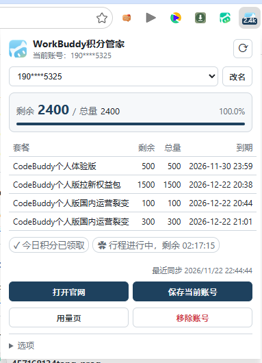

# WorkBuddy积分管家 — Chrome / Edge 插件

在浏览器工具栏查看 WorkBuddy 积分余量，自动领取每日积分和行程奖励。

## 功能

- 工具栏数字显示当前账号积分
- 弹窗查看剩余、总量、占比、套餐明细和到期时间
- 自动领取每日积分、自动结算行程奖励并发起下一趟行程
- 可手动领取奖励或发起行程
- 支持多个账号，切换时同步切换浏览器登录信息
- 自动同步间隔可调，默认 30 分钟
- 复用浏览器已有登录信息，不需要复制 Token
- 

## 安装

1. 打开 `chrome://extensions`（Edge 为 `edge://extensions`），启用「开发者模式」
2. 选择「加载已解压的扩展程序」，选中本目录
3. 工具栏出现图标即安装完成

## 使用

1. 点击插件里的「登录账号」，浏览器会打开登录页
2. 登录完成后回到插件，选择「保存当前账号」
3. 插件识别当前站点并保存登录信息，验证后显示积分

两个站点账号通用，插件会自动识别当前登录域名。

## 多账号

1. 在官网退出当前账号，登录另一个账号
2. 点插件的「保存当前账号」
3. 重复以上步骤添加更多账号
4. 用弹窗顶部下拉框切换账号

网站登录信息在浏览器里是全局的，同一时刻只保持一个账号登录。插件同步多个账号时会临时切换各账号的登录信息，结束后恢复到你当前选中的账号。

## 自动领取规则

### 触发时机

- 浏览器启动时更新所有账号
- 插件安装、更新或重新加载时更新所有账号
- 按设置的间隔定时更新，默认 30 分钟；填 `0` 可关闭定时更新
- 点击工具栏弹窗里的同步按钮可立即更新
- 同一天首次启动后台脚本时会自动补做一次更新

### 领取逻辑

1. 每日积分：先查询当天状态；未领取才调用领取接口；查询异常时本轮跳过
2. 行程奖励：仅在行程已结束、不在进行中时领取；同一趟行程只领取一次；奖励未到账时后续更新继续尝试
3. 发起行程：每账号每天自动发起一次；当日已达上限则跳过
4. 同步完成后更新工具栏数字和套餐明细
5. 有新领取或新发起的行程时弹出系统通知；登录失效或读取失败也会提示

### 选项

- 自动同步间隔（分钟，0 关闭）
- 自动领取每日积分
- 自动处理积分行程

关闭自动开关后，仍可手动领取奖励或发起行程。

## 账号名称

保存账号时自动读取网站账户名；占位名称会在下次同步时更新，也可用「改名」按钮手动设置。

## 数据存储

账号登录信息只保存在浏览器本地存储中，不上传。移除账号只删除插件保存的副本，不影响网站登录。

## 许可证

本项目采用 [MIT License](LICENSE)。
